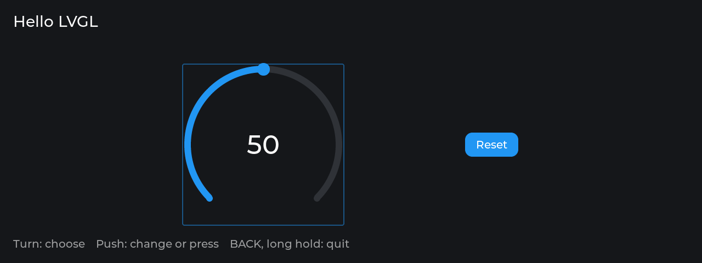

<!-- SPDX-License-Identifier: MPL-2.0 -->
# Hello LVGL

A dial and a button made of [LVGL](https://lvgl.io) widgets. LVGL draws in
software into a full-panel buffer; `src/display_gl.cpp` shows that buffer in
the SDK's OpenGL ES 2 window, uploading only what changed. Build and forms:
the [repository's README](../README.md).

The iDrive controller is what LVGL calls an encoder: turning moves the focus
from widget to widget, a push starts and ends changing the focused one, or
presses it. `src/main.cpp` feeds every input to that encoder.

## Touch screen

Drag the dial or tap Reset with one finger. The example registers an LVGL pointer alongside its iDrive encoder. This package requires bridge 1.10.

## Controls

| Action | iDrive controller | Xbox | DualShock 4 / DualSense | Desktop |
| --- | --- | --- | --- | --- |
| Choose, or change the dial | Turn the knob, or tilt | D-pad, left stick, or LB / RB | D-pad, left stick, or L1 / R1 | Arrows |
| Change or press | Push | A | Cross | Return |
| Quit | BACK, long hold | on the iDrive controller | on the iDrive controller | Close the window |

## Settings

Changed from the phone app or NBT Manager's settings page; they apply at once.

| Setting | Choices | Default |
| --- | --- | --- |
| Theme | dark, light | dark |
| Debug log | off, on | off |

## LVGL

LVGL 9.6 is the repository's submodule `third_party/lvgl`, unmodified, built
from its own source list (`lvgl.mk`) without its demos and examples, once per
kind of build (desktop, with the runner, without). `src/lv_conf.h` holds only
what differs from LVGL's defaults: a 32-bit buffer, the C library's allocator,
no assembly, the built-in Montserrat fonts in the sizes the screen uses.
LVGL's warnings go to the application's log.

A health check builds the screen and draws one frame off screen, so it covers
LVGL without a window. The package's notices carry LVGL's licence and its
fonts' (`make notice`).

## Layout

| Path | Contents |
| --- | --- |
| `src/main.cpp` | The application: the bridge, the window, LVGL, the loop; the controls |
| `src/ui.*` | The screen and its settings: widgets, the encoder, the theme |
| `src/display_gl.*` | LVGL's display on the SDK's window |
| `src/lv_conf.h` | LVGL's configuration |
| `tests/` | Launch, package and notice tests (`test_hello_lvgl.py`) |
| `release/` | The package description (`package.args`; `native.args` for the native form) |
| `docs/` | The animation above (`make anim`) |
